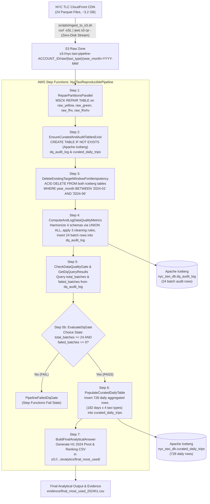

# NYC Taxi — Reproducible Data Lakehouse Pipeline (Submission 2)

End-to-end, reproducible serverless data lakehouse pipeline on **AWS (S3 + Glue Data Catalog + Athena + Apache Iceberg + Step Functions)** designed for **AWS Academy Learner Lab (`us-east-1`)**.

This pipeline operationalizes the Submission 1 baseline analysis (`submission1_baseline/submission1_duckdb_baseline.ipynb`) into an automated, idempotent, quality-gated workflow that answers the core question:

> **"Which taxi type was the most used in the first half of 2024? Convince us the answer is correct."**

---

## 1. Project Overview & Data Used

### 1.1 Metric Definition: "Most Used"
- **Metric**: Highest number of **valid trip records** (row count after applying data quality and deduplication rules) across January–June 2024.
- **Why Trip Record Count (and why fare/distance/passenger columns are intentionally NOT filtered)**:
  1. **Cross-Schema Comparability**: Traditional `fhv` records contain only 7 dispatch columns and completely lack `fare_amount`, `trip_distance`, and `passenger_count`. Trip record count is the only metric shared across all 4 NYC TLC fleets.
  2. **Physical Trip Integrity**: A trip with a `$0` or negative fare adjustment or `0` recorded distance still represents a physical dispatch/trip event. Filtering financial anomalies would distort physical usage counts. Only anomalies that affect **whether a row represents a distinct trip in the target month** are removed.

### 1.2 Data Scope & Source
- **Source**: [NYC TLC Trip Record Data](https://www.nyc.gov/site/tlc/about/tlc-trip-record-data.page) (`https://d37ci6vzurychx.cloudfront.net/trip-data/{taxi_type}_tripdata_2024-{month:02d}.parquet`)
- **Scope**: 4 taxi types (`yellow`, `green`, `fhv`, `fhvhv`) × 6 months (`2024-01` through `2024-06`) = **24 Parquet files** (~3.2 GB compressed, `149,685,672` raw rows → `149,415,376` valid deduplicated trips).

### 1.3 Heterogeneous Raw Schemas & Harmonization Mapping

Each taxi fleet uses different column names, casing conventions, and integer bit-widths across monthly Parquet files:

| Taxi Type | Raw Cols | Provider ID Column | Pickup Timestamp Column | Dropoff Timestamp Column | Pickup Zone Column | Dropoff Zone Column | Raw Schema Quirks Handled |
| :--- | :---: | :--- | :--- | :--- | :--- | :--- | :--- |
| **`yellow`** | 19 | `VendorID` (`INT`/`BIGINT`) | `tpep_pickup_datetime` | `tpep_dropoff_datetime` | `PULocationID` (`INT`/`BIGINT`) | `DOLocationID` (`INT`/`BIGINT`) | Charge/reversal pairs (`+fare` / `-fare`) share identical 5-key tuples (`full_row_duplicates = 0`). |
| **`green`** | 20 | `VendorID` (`INT`/`BIGINT`) | `lpep_pickup_datetime` | `lpep_dropoff_datetime` | `PULocationID` (`INT`/`BIGINT`) | `DOLocationID` (`INT`/`BIGINT`) | Includes `ehail_fee` and `trip_type`; charge/reversal pairs (`full_row_duplicates = 0`). |
| **`fhv`** | 7 | `dispatching_base_num` (`VARCHAR`) | `pickup_datetime` | `dropOff_datetime` *(capital `O`)* | `PUlocationID` *(lowercase `l`, `BIGINT`)* | `DOlocationID` *(lowercase `l`, `BIGINT`)* | No fare/distance columns; nullable location IDs; exact full-row dispatch resubmissions (`721–2,526`/mo). |
| **`fhvhv`** | 24 | `hvfhs_license_num` (`VARCHAR`) | `pickup_datetime` | `dropoff_datetime` | `PULocationID` (`INT`/`BIGINT`) | `DOLocationID` (`INT`/`BIGINT`) | High-volume app dispatches (Uber/Lyft); ~81% of all NYC trips (`full_row_duplicates = 0`). |

All 4 raw schemas are harmonized at the query boundary into a canonical 7-column tuple:
`(taxi_type, year_month, provider_id, pickup_dt, dropoff_dt, pu_id, do_id)`.

---

## 2. Pipeline Architecture & Data Flow Diagram

### 2.1 Lakehouse Storage Layout (`s3://nyc-taxi-pipeline-<ACCOUNT_ID>/`)
- **Raw Zone (External Parquet)**: `s3://${BUCKET_NAME}/raw/{taxi_type}/year_month={YYYY-MM}/{taxi_type}_tripdata_{YYYY-MM}.parquet`
- **Data Quality Audit Zone (Apache Iceberg)**: `s3://${BUCKET_NAME}/dq_audit/` (`nyc_taxi_db.dq_audit_log`)
- **Curated Zone (Apache Iceberg)**: `s3://${BUCKET_NAME}/curated/daily_trips/` (`nyc_taxi_db.curated_daily_trips`)
- **Final Analytics Mart (CSV Output)**: `s3://${BUCKET_NAME}/analytics/final_most_used/`

### 2.2 End-to-End Pipeline Architecture Diagram



### 2.3 Repository Structure

```text
Taxianalysis/
├── template.yaml                      # CloudFormation stack: Glue DB, 4 Raw Tables, Step Functions State Machine
├── scripts/
│   ├── deploy_and_run.sh              # 1-command CloudShell deployment, ingestion, execution & evidence export
│   ├── ingest_to_s3.sh                # Idempotent zero-disk CloudFront -> S3 streaming script
│   └── export_evidence.sh             # Exports Step Functions JSON & Athena CSVs into evidence/
├── sql/
│   ├── 01_ddl_iceberg_tables.sql      # Standalone DDL for partition repair & Iceberg tables
│   ├── 02_dq_and_curated_load.sql     # Standalone DML for idempotent DELETE, DQ audit logging & curated load
│   └── 03_final_analytics_mart.sql    # Standalone analytical query producing the H1 2024 ranking pivot
├── evidence/
│   ├── stepfunctions_execution.json   # Step Functions describe-execution status payload
│   ├── dq_audit_results.csv           # Full 24-row export from nyc_taxi_db.dq_audit_log
│   ├── curated_sample_data.csv        # Sample export from nyc_taxi_db.curated_daily_trips
│   └── final_most_used_2024h1.csv     # Final H1 2024 ranking & monthly breakdown table
├── submission1_baseline/
│   └── submission1_duckdb_baseline.ipynb # Archived Submission 1 Baseline Notebook (DuckDB reference)
└── README.md                          # Complete architecture, setup, results & design documentation
```

---

## 3. Step-by-Step Setup & Execution Guide

### 3.1 Prerequisites
- **Environment**: AWS Academy Learner Lab (`us-east-1`) with an active lab session.
- **IAM Role**: Uses the pre-created `LabRole` (`arn:aws:iam::<ACCOUNT_ID>:role/LabRole`), respecting the Learner Lab restriction where `iam:CreateRole` is denied.

### 3.2 One-Command Deployment & Execution (AWS CloudShell)
Open **AWS CloudShell** in `us-east-1` and run:

```bash
git clone https://github.com/PhurinKaewpuangsek/Taxianalysis.git
cd Taxianalysis
chmod +x scripts/*.sh
./scripts/deploy_and_run.sh
```

What `./scripts/deploy_and_run.sh` does automatically:
1. Detects your AWS `ACCOUNT_ID` via STS and resolves `arn:aws:iam::<ACCOUNT_ID>:role/LabRole`.
2. Creates the S3 bucket `s3://nyc-taxi-pipeline-${ACCOUNT_ID}` if it does not exist.
3. Invokes `./scripts/ingest_to_s3.sh` to stream all 24 Parquet files directly from CloudFront into S3 (`raw/{taxi_type}/year_month={YYYY-MM}/`) without using CloudShell local disk.
4. Deploys `template.yaml` via `aws cloudformation deploy` (creating `nyc_taxi_db`, `raw_yellow`, `raw_green`, `raw_fhv`, `raw_fhvhv`, and `NycTaxiReproduciblePipeline`).
5. Starts a Step Functions execution, polls every 10 seconds until `SUCCEEDED`, and runs `./scripts/export_evidence.sh` to refresh all 4 files in `evidence/`.

### 3.3 Running Incremental Updates or Re-Runs
- **Idempotent Re-Run (Same Window)**:
  Re-running `./scripts/deploy_and_run.sh` skips already-uploaded S3 Parquet files (`[SKIP] Exists in S3`), executes `DELETE FROM` on the target window in both Apache Iceberg tables, re-verifies the 24-batch DQ gate, and reloads the curated table with **zero duplicate rows**.
- **Ingesting New Months (e.g., July 2024)**:
  ```bash
  ./scripts/ingest_to_s3.sh "nyc-taxi-pipeline-$(aws sts get-caller-identity --query Account --output text)" 2024 "07"
  ```
- **Force Overwriting S3 Raw Files**:
  ```bash
  FORCE=true ./scripts/ingest_to_s3.sh
  ```

---

## 4. Data Quality Framework & Evidence Summary

### 4.1 The 3 Cleaning Rules & Diagnostic Proof
Every batch `(taxi_type, year_month)` is evaluated against three rules before entering `curated_daily_trips`:
1. **Non-Null Pickup Timestamp**: `pickup_dt IS NOT NULL`
2. **Strict Target-Month Boundary**: `pickup_dt >= month_start AND pickup_dt < next_month_start` (removes stray timestamps from adjacent years/months).
3. **5-Key Deduplication**: `GROUP BY (taxi_type, year_month, provider_id, pickup_dt, dropoff_dt, pu_id, do_id)`.
   - **Why 5-Key Deduplication is Proven Safe Across All 24 Files**:
     - **Pattern A (`yellow`, `green`, `fhvhv`)**: Full-row duplicate diagnostics in Submission 1 (Phase 7) proved `full_row_duplicates = 0` across all 18 files of these three fleets. Every 5-key collision is a payment charge/reversal pair (`+fare` and `-fare` with identical trip timestamps and locations), which must be collapsed into 1 physical trip.
     - **Pattern B (`fhv`)**: `fhv` contains `721–2,526` exact full-row duplicates per month caused by dispatch log resubmissions. Deduplicating on the 5 keys removes these exact duplicates cleanly.
4. **Automated DQ Gate Criteria**:
   - Each batch is marked `dq_status = 'PASS'` in `nyc_taxi_db.dq_audit_log` if and only if `valid_deduped_count > 0` AND `removed_pct < 5.0%`.
   - Step Functions (`EvaluateDqGate`) verifies `total_batches == "24"` and `failed_batches == "0"` before populating `curated_daily_trips`.

### 4.2 Summary of DQ Audit Log (`evidence/dq_audit_results.csv`)

| Taxi Type | Batches | Raw Rows (H1 2024) | Null Pickup | Out-of-Month | Bad Order (`dropoff < pickup`) | Valid Deduped Rows | Total Removed Rows | Removed % Range | DQ Status |
| :--- | :---: | ---: | ---: | ---: | ---: | ---: | ---: | :---: | :---: |
| **`fhvhv`** | 6 / 6 | 120,864,660 | 0 | 0 | 0 | **120,864,438** | 222 | `0.0002%` | **PASS (6/6)** |
| **`yellow`** | 6 / 6 | 20,332,093 | 0 | 151 | 381 | **20,105,833** | 226,260 | `1.0499% – 1.2128%` | **PASS (6/6)** |
| **`fhv`** | 6 / 6 | 8,121,348 | 0 | 0 | 0 | **8,106,509** | 14,839 | `0.1450% – 0.2046%` | **PASS (6/6)** |
| **`green`** | 6 / 6 | 339,807 | 0 | 20 | 10 | **338,596** | 1,211 | `0.3236% – 0.3860%` | **PASS (6/6)** |
| **Total** | **24 / 24** | **149,657,908** | **0** | **171** | **391** | **149,415,376** | **242,532** | **`0.1621%` overall** | **PASS (24/24)** |

### 4.3 Exported Evidence Artifacts (`evidence/`)
- [`evidence/stepfunctions_execution.json`](evidence/stepfunctions_execution.json): Full `aws stepfunctions describe-execution` JSON output proving `"status": "SUCCEEDED"`.
- [`evidence/dq_audit_results.csv`](evidence/dq_audit_results.csv): All 24 monthly audit rows exported from `nyc_taxi_db.dq_audit_log`.
- [`evidence/curated_sample_data.csv`](evidence/curated_sample_data.csv): Sample daily aggregated records from `nyc_taxi_db.curated_daily_trips` (`728` total rows = `182` days × `4` taxi types, including distinct pickup/dropoff zone counts).
- [`evidence/final_most_used_2024h1.csv`](evidence/final_most_used_2024h1.csv): Final H1 2024 ranking and monthly pivot output.

---

## 5. Final Analytical Result & Calendar-Effect Insights

### 5.1 H1 2024 Valid Trip Counts by Taxi Type (`evidence/final_most_used_2024h1.csv`)

| Rank | Taxi Type | Jan 2024 | Feb 2024 | Mar 2024 | Apr 2024 | May 2024 | Jun 2024 | Total H1 2024 Valid Trips | Avg Daily Trips (182 Days) | Share of Total (%) |
| :---: | :--- | ---: | ---: | ---: | ---: | ---: | ---: | ---: | ---: | ---: |
| **1** | **`fhvhv`** | 19,663,892 | 19,359,106 | 21,280,755 | 19,733,002 | 20,704,501 | 20,123,182 | **120,864,438** | **664,090** | **80.89%** |
| **2** | **`yellow`** | 2,933,498 | 2,975,879 | 3,543,701 | 3,475,892 | 3,680,592 | 3,496,271 | **20,105,833** | **110,472** | **13.46%** |
| **3** | **`fhv`** | 1,287,477 | 1,175,188 | 1,467,947 | 1,441,976 | 1,349,878 | 1,384,043 | **8,106,509** | **44,541** | **5.43%** |
| **4** | **`green`** | 56,368 | 53,399 | 57,252 | 56,253 | 60,769 | 54,555 | **338,596** | **1,860** | **0.23%** |
| — | **All Taxis** | **23,941,235** | **23,563,572** | **26,349,655** | **24,707,123** | **25,795,740** | **25,058,051** | **149,415,376** | **820,964** | **100.00%** |

**Conclusion**: **High-Volume For-Hire Vehicles (`fhvhv`)** was the most used taxi type in the first half of 2024 with **120,864,438 valid trips** (**80.89%** of all NYC trips)—more than **6× higher** than second-place `yellow` (`20,105,833`). Because total rows removed by cleaning across all fleets is `< 1.22%`, no variation in cleaning thresholds could alter the winner.

### 5.2 Calendar-Effect Normalization (Daily Average Trips/Day by Month)
Because `curated_daily_trips` stores data at `pickup_date` granularity (`182` days across H1 2024), normalizing monthly totals by the number of calendar days in each month (`Jan=31, Feb=29 [leap year], Mar=31, Apr=30, May=31, Jun=30`) explains the apparent February dip and March spike:

| Taxi Type | Jan (31d) | Feb (29d) | Mar (31d) | Apr (30d) | May (31d) | Jun (30d) | H1 Trend Interpretation |
| :--- | ---: | ---: | ---: | ---: | ---: | ---: | :--- |
| **`fhvhv`** | 634,319/d | 667,555/d | 686,476/d | 657,767/d | 667,887/d | 670,773/d | **Flat high-volume plateau** (~634K–686K/day); raw Feb dip was purely due to 29 calendar days. |
| **`yellow`** | 94,629/d | 102,617/d | 114,313/d | 115,863/d | 118,729/d | 116,542/d | **Real demand growth (+25.5%)** from Jan (`94.6K/d`) to May (`118.7K/d`) even after removing calendar effects. |
| **`fhv`** | 41,532/d | 40,524/d | 47,353/d | 48,066/d | 43,544/d | 46,135/d | Moderate seasonal fluctuation (`40.5K–48.1K/d`). |
| **`green`** | 1,818/d | 1,841/d | 1,847/d | 1,875/d | 1,960/d | 1,819/d | **Flat baseline** (`1,818–1,960/d`). |

---

## 6. Key Pipeline Design Decisions & Rationale

### Decision 1: Schema Harmonization, Case-Insensitive Parquet Resolution & Null-Safe 5-Key Deduplication at the Lakehouse Boundary
- **Problem**: The 24 raw NYC TLC Parquet files suffer from three physical incompatibilities:
  1. Column name casing varies (`dropOff_datetime` and `PUlocationID`/`DOlocationID` in `fhv` vs. `dropoff_datetime` and `PULocationID`/`DOLocationID` in `fhvhv`/`yellow`/`green`).
  2. Integer bit-widths drift across months between `INT32` (`int`) and `INT64` (`bigint`) for `VendorID`, `PULocationID`, and `DOLocationID`, causing `HIVE_BAD_DATA` errors in Athena if typed as `int`.
  3. `fhv` frequently contains `NULL` in `PUlocationID` and `DOlocationID`; using `COUNT(DISTINCT col1, col2, ...)` in SQL silently drops any row where a column is `NULL`.
- **Decision**:
  1. Set `"parquet.column.index.access": "false"` on all 4 Glue raw tables (`template.yaml`) so Athena resolves Parquet columns by name case-insensitively.
  2. Define `vendorid`, `pulocationid`, and `dolocationid` as `bigint` in the Glue catalog so Athena widens `INT32` to `BIGINT` without schema errors.
  3. Harmonize all 4 tables via `UNION ALL` and deduplicate using `GROUP BY (taxi_type, year_month, provider_id, pickup_dt, dropoff_dt, pu_id, do_id)` after filtering for valid in-month timestamps.
- **Rationale**: In Trino/Athena, `GROUP BY` treats `NULL` values as equal group keys (matching DuckDB's `SELECT DISTINCT ON (...)` semantics from Submission 1) and enables distributed partial hash aggregation across worker nodes before shuffling, reproducing all 24 monthly ground-truth counts to the exact single trip.

### Decision 2: Idempotent Apache Iceberg `DELETE + INSERT` Guarded by a Step Functions `Choice` Data Quality Gate
- **Problem**: Standard Hive external tables append duplicate files when an `INSERT INTO` query is re-run, and un-gated pipelines can overwrite downstream analytics tables with corrupted or partial loads.
- **Decision**: Store both `dq_audit_log` and `curated_daily_trips` as **Apache Iceberg** tables (`'table_type' = 'ICEBERG'`). At the start of each run (`DeleteExistingTargetWindowForIdempotency`), execute an ACID `DELETE FROM ... WHERE year_month BETWEEN '2024-01' AND '2024-06'`, compute batch DQ metrics into `dq_audit_log`, and evaluate `EvaluateDqGate` (`total_batches == "24"` and `failed_batches == "0"`) before allowing `PopulateCuratedDailyTable` to run.
- **Rationale**: Iceberg ACID transactions guarantee that re-running the pipeline N times produces the exact same 24 audit rows and 728 curated daily rows (zero duplicate accumulation), while the Step Functions `Choice` gate halts execution immediately (`PipelineFailedDqGate`) if any file is missing or exceeds the 5.0% anomaly threshold.

### Decision 3: Zero-Disk CloudFront-to-S3 Streaming Ingestion (`curl | aws s3 cp -`)
- **Problem**: AWS CloudShell enforces a strict **1 GB persistent home directory limit**, whereas the 24 Parquet files total **~3.2 GB**. Downloading files locally before uploading would crash CloudShell with `No space left on device`.
- **Decision**: Stream bytes directly from CloudFront into S3 multipart upload buffers in `scripts/ingest_to_s3.sh` (`curl --retry 3 -sSL --fail "${source_url}" | aws s3 cp - "${s3_uri}"`), guarded by an `aws s3api head-object` check.
- **Rationale**: Uses zero local disk space, survives transient network drops via retries, and completes subsequent runs in seconds by skipping existing S3 objects unless `FORCE=true`.

---

## 7. Comparison: How Submission 2 Improves Upon Submission 1 Baseline

| Dimension | Submission 1 Baseline (`submission1_baseline/submission1_duckdb_baseline.ipynb`) | Submission 2 Reproducible Pipeline (AWS Lakehouse) |
| :--- | :--- | :--- |
| **Execution Model** | Manual cell-by-cell execution in Google Colab. | Automated 7-stage **AWS Step Functions** state machine (`NycTaxiReproduciblePipeline`) deployed via 1 command. |
| **Data Ingestion & Storage** | Ephemeral local disk (`/content/data/nyc_taxi_2024`) wiped whenever Colab disconnects; fails on <1 GB environments. | Durable, Hive-partitioned **Amazon S3 Raw Zone** (`year_month=YYYY-MM`) populated via zero-disk CloudFront-to-S3 streaming. |
| **Schema Integration** | Python dictionary loop (`TAXI_CONFIG`) running 24 separate single-file DuckDB queries. | Unified **AWS Glue Data Catalog** (`nyc_taxi_db`) with case-insensitive Parquet SerDe + harmonized distributed **Athena `UNION ALL`** SQL. |
| **Curated Output Layer** | In-memory Pandas `summary_df` (24 monthly numbers only; no persistent curated dataset). | Persistent **Apache Iceberg** table (`curated_daily_trips`, 728 daily rows with distinct pickup/dropoff zone coverage) ready for downstream BI/analytics. |
| **Reproducibility & Idempotency** | Re-running requires re-downloading 3.2 GB and re-executing notebook cells manually. | Infrastructure-as-Code (`template.yaml`), `head-object` ingestion skip, and ACID Iceberg `DELETE + INSERT` window replacement. |
| **Data Quality Enforcement** | Post-hoc Python `assert` statements after all 24 files finished processing. | Pre-load **`dq_audit_log` Iceberg table** + Step Functions **`EvaluateDqGate` Choice state** that blocks curated table loads if any batch fails DQ rules. |

---

## 8. Current Pipeline Limitations

1. **AWS Academy Learner Lab IAM & Session Constraints**: Because `iam:CreateRole` is restricted in Learner Lab, all services share the broad `LabRole` rather than least-privilege per-service IAM roles, and the lab session pauses after the 4-hour Learner Lab timer expires.
2. **Batch Window Parameterization in Step Functions SQL**: While `scripts/ingest_to_s3.sh` accepts dynamic `YEAR` and `MONTHS` arguments, the SQL queries inside `template.yaml` currently target the `2024-01` to `2024-06` window (`WHERE year_month BETWEEN '2024-01' AND '2024-06'`). Supporting arbitrary dynamic windows in Step Functions would require passing `$.start_month` and `$.end_month` via `States.Format` in the ASL definition.
3. **5-Key Deduplication Scope at Month Boundaries**: Deduplication is scoped within each `year_month` partition (after filtering `pickup_dt` to that month) to match the Submission 1 baseline; a trip dispatched at `23:59:59` on the last day of a month whose duplicate record was somehow logged in the next month's file would already be filtered out by the target-month timestamp rule.
4. **No Real-Time Streaming Trigger**: Ingestion is triggered via CLI (`deploy_and_run.sh`) rather than an automated EventBridge schedule because NYC TLC publishes monthly Parquet batches on an irregular ~2-month delay.

---

## 9. Learning Reflection

การพัฒนางานจาก Notebook ใน Submission 1 มาเป็น Reproducible Data Pipeline บน AWS ใน Submission 2 ทำให้เข้าใจความแตกต่างระหว่างการวิเคราะห์ข้อมูลแบบเฉพาะกิจ (Ad-hoc Analysis) กับการออกแบบระบบวิศวกรรมข้อมูลที่รันซ้ำได้ในระดับ Production อย่างชัดเจน โดยเฉพาะการจัดการความแตกต่างของ Schema ทั้ง 4 ประเภทแท็กซี่ตั้งแต่ชั้น Glue Data Catalog (`parquet.column.index.access = false` และการใช้ `BIGINT` รองรับทั้ง `INT32`/`INT64`) และการเขียน SQL เชิงกระจายบน Athena ที่ต้องระวังเรื่อง `NULL` ในคีย์ที่ใช้ตัดข้อมูลซ้ำให้ได้ผลลัพธ์ตรงกับ DuckDB ทุกแถว นอกจากนี้ การใช้ตาราง Apache Iceberg ร่วมกับ Step Functions Choice State ในการทำ Data Quality Gate ก่อนบันทึกข้อมูลลงชั้น Curated ช่วยให้มั่นใจได้ว่าการรัน Pipeline ซ้ำทุกครั้งจะมีความเป็น Idempotent ไม่มีข้อมูลซ้ำซ้อน และตรวจสอบย้อนกลับได้ครบทุกขั้นตอน อีกทั้งข้อจำกัดด้านพื้นที่จัดเก็บ 1 GB ของ AWS CloudShell ยังสอนให้รู้จักออกแบบกระบวนการ Ingestion แบบ Streaming (`curl | aws s3 cp -`) ที่แก้ปัญหาคอขวดของทรัพยากรได้อย่างมีประสิทธิภาพ
