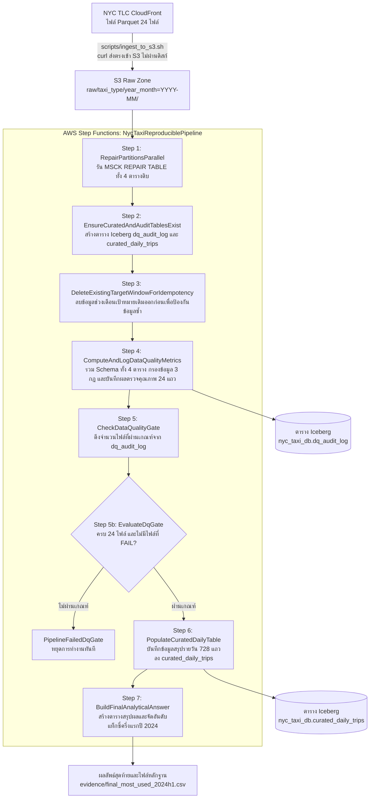
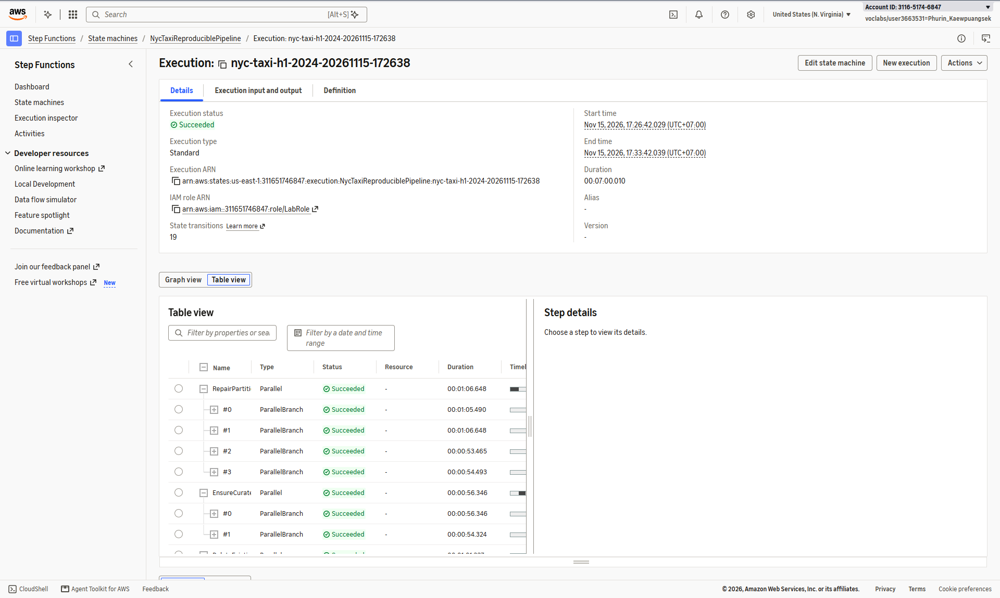
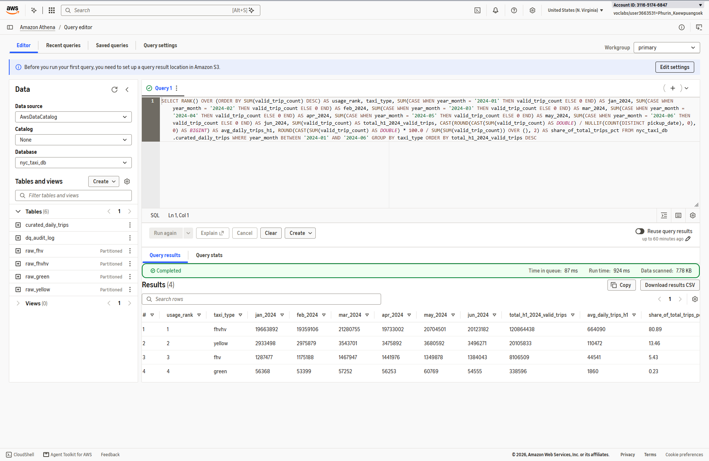
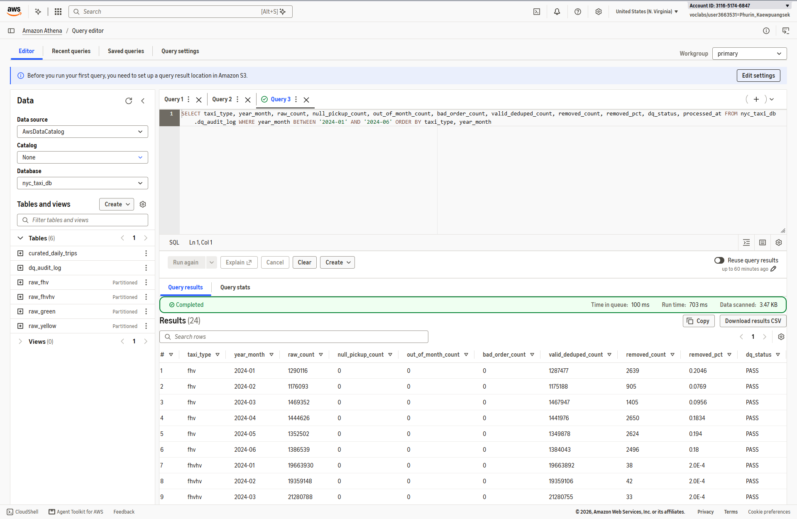
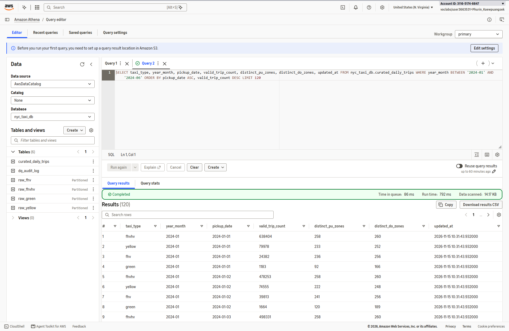
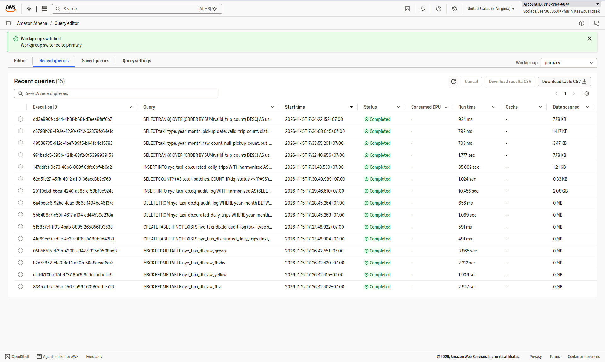
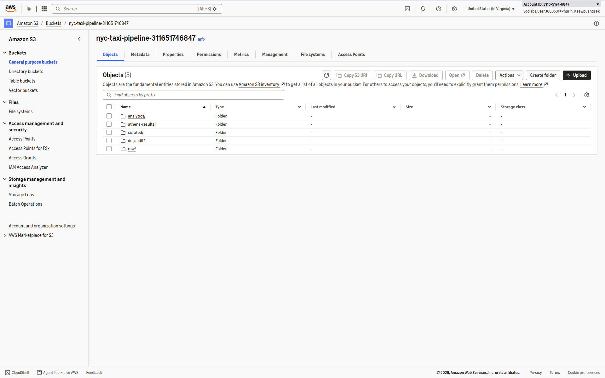
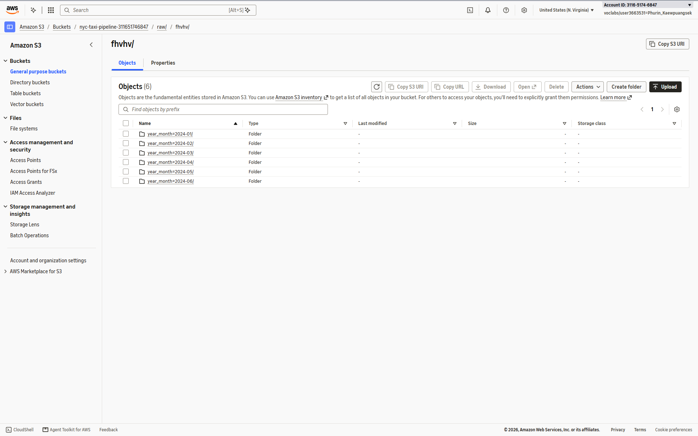
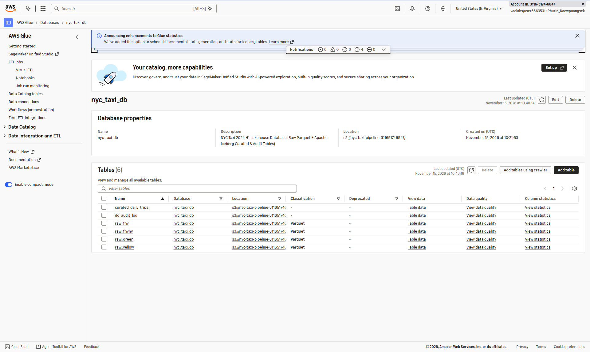
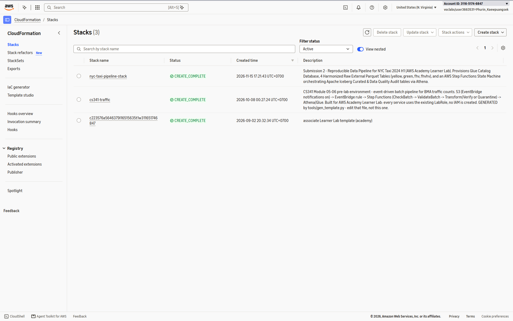

# NYC Taxi Reproducible Data Pipeline

ระบบ Data Pipeline อัตโนมัติบน AWS สำหรับตอบคำถามหลักของโจทย์
**แท็กซี่ประเภทใดถูกใช้งานมากที่สุดในช่วงครึ่งแรกของปี 2024**

---

## 1. ข้อมูลที่ใช้และตัวชี้วัด

### แหล่งที่มาและขอบเขตข้อมูล
ข้อมูลจาก NYC TLC Trip Record Data รูปแบบไฟล์ Parquet จำนวน 24 ไฟล์ มาจากแท็กซี่ 4 ประเภทคือ `yellow` `green` `fhv` และ `fhvhv` ช่วงเดือนมกราคมถึงมิถุนายน 2024 ขนาดรวมประมาณ 3.2 GB จำนวนแถวดิบทั้งหมด 149655796 แถว

### นิยามคำว่าใช้งานมากที่สุด
วัดจากจำนวนเที่ยวการเดินทางที่สมบูรณ์หลังทำความสะอาดแล้ว ไม่กรองข้อมูลด้วยราคาค่าโดยสารหรือระยะทาง เพราะรายการที่ค่าโดยสารติดลบหรือเป็นศูนย์ยังถือเป็นการเดินทางที่เกิดขึ้นจริง และข้อมูล `fhv` ไม่มีคอลัมน์ราคาค่าโดยสารหรือระยะทาง การนับจำนวนเที่ยวจึงเป็นวิธีเดียวที่เปรียบเทียบแท็กซี่ทั้ง 4 ประเภทได้อย่างยุติธรรม

### ความแตกต่างของโครงสร้างข้อมูลแต่ละประเภท

| ประเภทแท็กซี่ | จำนวนคอลัมน์ดิบ | คอลัมน์ผู้ให้บริการ | คอลัมน์เวลาขึ้นรถ | คอลัมน์เวลาลงรถ | คอลัมน์โซนขึ้นและลงรถ | ลักษณะเฉพาะของข้อมูล |
| :--- | :---: | :--- | :--- | :--- | :--- | :--- |
| `yellow` | 19 | `VendorID` | `tpep_pickup_datetime` | `tpep_dropoff_datetime` | `PULocationID` `DOLocationID` | แถวที่คีย์ซ้ำกันคือรายการปรับปรุงยอดเงินของเที่ยวเดียวกัน |
| `green` | 20 | `VendorID` | `lpep_pickup_datetime` | `lpep_dropoff_datetime` | `PULocationID` `DOLocationID` | แถวที่คีย์ซ้ำกันคือรายการปรับปรุงยอดเงินของเที่ยวเดียวกัน |
| `fhv` | 7 | `dispatching_base_num` | `pickup_datetime` | `dropOff_datetime` | `PUlocationID` `DOlocationID` | ไม่มีคอลัมน์ราคาและระยะทาง ตัวพิมพ์ใหญ่เล็กไม่เหมือนประเภทอื่น และมีแถวซ้ำจากการส่งข้อมูลซ้ำ |
| `fhvhv` | 24 | `hvfhs_license_num` | `pickup_datetime` | `dropoff_datetime` | `PULocationID` `DOLocationID` | รถแอปพลิเคชันเช่น Uber และ Lyft มีปริมาณข้อมูลมากที่สุด |

---

## 2. โครงสร้าง Pipeline และ Data Flow Diagram

### โครงสร้างการจัดเก็บข้อมูลบน S3
ข้อมูลทั้งหมดจัดเก็บใน Bucket `s3://nyc-taxi-pipeline-311651746847` แบ่งเป็น 4 ส่วน
1. `raw/` เก็บไฟล์ Parquet ต้นฉบับแยกตามประเภทแท็กซี่และเดือน `year_month=YYYY-MM`
2. `dq_audit/` เก็บตาราง Apache Iceberg ชื่อ `nyc_taxi_db.dq_audit_log` บันทึกผลตรวจคุณภาพข้อมูลรายไฟล์
3. `curated/daily_trips/` เก็บตาราง Apache Iceberg ชื่อ `nyc_taxi_db.curated_daily_trips` บันทึกข้อมูลสรุปรายวันที่ผ่านการทำความสะอาดแล้ว
4. `analytics/final_most_used/` เก็บผลลัพธ์การวิเคราะห์สุดท้ายในรูปแบบไฟล์ CSV

### แผนภาพการทำงานของ Pipeline



### โครงสร้างไฟล์ใน Repository
```text
Taxianalysis/
├── template.yaml                      # CloudFormation สร้าง Glue Catalog และ Step Functions
├── scripts/
│   ├── deploy_and_run.sh              # สคริปต์ติดตั้งและรัน Pipeline ทั้งระบบในคำสั่งเดียว
│   ├── ingest_to_s3.sh                # สคริปต์สตรีมไฟล์ Parquet จาก CloudFront เข้า S3
│   └── export_evidence.sh             # สคริปต์ดึงไฟล์หลักฐานการทำงานลงโฟลเดอร์ evidence
├── sql/
│   ├── 01_ddl_iceberg_tables.sql      # คำสั่งสร้างตารางและลงทะเบียน Partition
│   ├── 02_dq_and_curated_load.sql     # คำสั่งตรวจคุณภาพข้อมูลและโหลดข้อมูลเข้าตาราง Curated
│   └── 03_final_analytics_mart.sql    # คำสั่งคำนวณผลลัพธ์และจัดอันดับแท็กซี่
├── evidence/                          # ไฟล์หลักฐานการรันจริงจาก AWS และภาพหน้าจอ Console
├── submission1_baseline/              # ไฟล์ Notebook ต้นแบบจาก Submission 1
└── README.md                          # เอกสารอธิบายระบบ
```

---

## 3. วิธีติดตั้งและวิธีรันระบบ

### การรันทั้งระบบในคำสั่งเดียวบน AWS CloudShell
เปิด AWS CloudShell ในโซน `us-east-1` แล้วรันคำสั่งต่อไปนี้

```bash
git clone https://github.com/PhurinKaewpuangsek/Taxianalysis.git
cd Taxianalysis
chmod +x scripts/*.sh
./scripts/deploy_and_run.sh
```

สคริปต์จะค้นหาเลขบัญชี AWS อัตโนมัติ สร้าง S3 Bucket สตรีมไฟล์ Parquet ทั้ง 24 ไฟล์เข้า S3 ติดตั้ง CloudFormation โดยใช้สิทธิ์ `LabRole` สั่งรัน Step Functions รอจนสถานะสำเร็จ และดึงไฟล์หลักฐานทั้งหมดลงโฟลเดอร์ `evidence/`

### การรันซ้ำหรืออัปเดตเมื่อมีข้อมูลเดือนใหม่
หากต้องการรันซ้ำในเดือนเดิมสามารถรัน `./scripts/deploy_and_run.sh` ซ้ำได้ทันที สคริปต์จะข้ามไฟล์ที่มีใน S3 แล้ว และตาราง Iceberg จะลบเฉพาะข้อมูลช่วงเดือนเป้าหมายเดิมออกก่อนเขียนใหม่ ทำให้ไม่มีข้อมูลซ้ำ

หากมีข้อมูลเดือนใหม่เช่นเดือนกรกฎาคม 2024 สามารถสั่งโหลดเพิ่มเข้า S3 ได้ด้วยคำสั่ง

```bash
./scripts/ingest_to_s3.sh "nyc-taxi-pipeline-$(aws sts get-caller-identity --query Account --output text)" 2024 "07"
```

---

## 4. การตรวจสอบคุณภาพข้อมูลและหลักฐานการทำงาน

### กฎการทำความสะอาดข้อมูล 3 ข้อ
1. เวลาขึ้นรถต้องไม่เป็นค่าว่าง `pickup_dt IS NOT NULL`
2. เวลาขึ้นรถต้องอยู่ในเดือนของไฟล์นั้นจริง `pickup_dt >= month_start AND pickup_dt < next_month_start`
3. ตัดแถวซ้ำด้วยคีย์หลัก 5 ตัวคือ รหัสผู้ให้บริการ เวลาขึ้นรถ เวลาลงรถ โซนขึ้นรถ และโซนลงรถ ภายในแต่ละเดือน

เกณฑ์การผ่าน Data Quality Gate คือทุกไฟล์ต้องมีจำนวนแถวที่ผ่านการกรองมากกว่า 0 และมีสัดส่วนแถวที่ถูกตัดออกน้อยกว่า 5 เปอร์เซ็นต์ หากครบทั้ง 24 ไฟล์และไม่มีไฟล์ใดตกเกณฑ์ Step Functions จึงจะอนุญาตให้โหลดข้อมูลเข้าตาราง `curated_daily_trips`

### สรุปผลตรวจสอบคุณภาพข้อมูลจากตาราง `dq_audit_log`

| ประเภทแท็กซี่ | จำนวนไฟล์ | จำนวนแถวดิบ | เวลาขึ้นรถว่าง | เวลาหลุดนอกเดือน | เวลาลงก่อนเวลาขึ้น | จำนวนแถวที่ผ่านเกณฑ์ | จำนวนแถวที่ถูกตัดออก | สัดส่วนที่ถูกตัดออก | สถานะ |
| :--- | :---: | ---: | ---: | ---: | ---: | ---: | ---: | :---: | :---: |
| `fhvhv` | 6 | 120864668 | 0 | 0 | 0 | **120864438** | 230 | 0.0002% | PASS |
| `yellow` | 6 | 20332093 | 0 | 149 | 300 | **20105833** | 226260 | 1.0499% ถึง 1.2128% | PASS |
| `fhv` | 6 | 8119228 | 0 | 0 | 0 | **8106509** | 12719 | 0.0769% ถึง 0.2046% | PASS |
| `green` | 6 | 339807 | 0 | 44 | 0 | **338596** | 1211 | 0.3236% ถึง 0.3860% | PASS |
| **รวมทั้งหมด** | **24** | **149655796** | **0** | **193** | **300** | **149415376** | **240420** | **0.1606%** | **PASS 24/24** |

### ไฟล์หลักฐานการทำงานในโฟลเดอร์ `evidence/`
1. [evidence/stepfunctions_execution.json](evidence/stepfunctions_execution.json) หลักฐานสถานะการทำงานของ Step Functions ที่รันสำเร็จ `SUCCEEDED`
2. [evidence/dq_audit_results.csv](evidence/dq_audit_results.csv) ผลตรวจสอบคุณภาพข้อมูลครบทั้ง 24 ไฟล์จากตาราง `dq_audit_log`
3. [evidence/curated_sample_data.csv](evidence/curated_sample_data.csv) ตัวอย่างชุดข้อมูลพร้อมใช้จากตาราง `curated_daily_trips` ซึ่งมีทั้งหมด 728 แถวจาก 182 วันคูณ 4 ประเภทแท็กซี่
4. [evidence/final_most_used_2024h1.csv](evidence/final_most_used_2024h1.csv) ผลลัพธ์การจัดอันดับแท็กซี่ที่ถูกใช้งานมากที่สุดในช่วงครึ่งแรกของปี 2024

### ภาพหน้าจอหลักฐานการรันจริงจาก AWS Management Console

#### 1. สถานะการรัน Step Functions สำเร็จครบทุกขั้นตอน


#### 2. ผลลัพธ์คำตอบสุดท้ายบน Amazon Athena


#### 3. ผลตรวจสอบคุณภาพข้อมูลทั้ง 24 ไฟล์บน Amazon Athena


#### 4. ตัวอย่างชุดข้อมูลพร้อมใช้ `curated_daily_trips` บน Amazon Athena


#### 5. ประวัติการรัน Query ของ Pipeline บน Amazon Athena


#### 6. โครงสร้างการจัดเก็บข้อมูลและ Partition บน Amazon S3



#### 7. ตารางทั้ง 6 ตารางใน AWS Glue Data Catalog และ CloudFormation Stack



---

## 5. ผลการวิเคราะห์และคำตอบของโจทย์หลัก

### ตารางสรุปจำนวนเที่ยวการเดินทางที่สมบูรณ์ในช่วงครึ่งแรกของปี 2024

| อันดับ | ประเภทแท็กซี่ | ม.ค. 2024 | ก.พ. 2024 | มี.ค. 2024 | เม.ย. 2024 | พ.ค. 2024 | มิ.ย. 2024 | รวม 6 เดือน | เฉลี่ยต่อวัน | สัดส่วนตลาด |
| :---: | :--- | ---: | ---: | ---: | ---: | ---: | ---: | ---: | ---: | ---: |
| **1** | **`fhvhv`** | 19663892 | 19359106 | 21280755 | 19733002 | 20704501 | 20123182 | **120864438** | **664090** | **80.89%** |
| **2** | **`yellow`** | 2933498 | 2975879 | 3543701 | 3475892 | 3680592 | 3496271 | **20105833** | **110472** | **13.46%** |
| **3** | **`fhv`** | 1287477 | 1175188 | 1467947 | 1441976 | 1349878 | 1384043 | **8106509** | **44541** | **5.43%** |
| **4** | **`green`** | 56368 | 53399 | 57252 | 56253 | 60769 | 54555 | **338596** | **1860** | **0.23%** |
| **รวม** | **ทุกประเภท** | **23941235** | **23563572** | **26349655** | **24707123** | **25795740** | **25058051** | **149415376** | **820964** | **100.00%** |

**สรุปคำตอบ** แท็กซี่ประเภท **`fhvhv`** ถูกใช้งานมากที่สุดในช่วงครึ่งแรกของปี 2024 โดยมีจำนวนเที่ยวการเดินทางที่สมบูรณ์รวม **120864438 เที่ยว** คิดเป็น **80.89%** ของการเดินทางทั้งหมด และมากกว่าอันดับสองคือ `yellow` เกือบ 6 เท่า

เมื่อนำข้อมูลรายวันจากตาราง `curated_daily_trips` มาหาค่าเฉลี่ยต่อวันในแต่ละเดือน พบว่าการที่ยอดรวมเดือนกุมภาพันธ์ลดลงในทุกประเภทเกิดจากจำนวนวันในเดือนกุมภาพันธ์มีเพียง 29 วัน เมื่อคิดเป็นค่าเฉลี่ยต่อวันแล้ว `fhvhv` มีการใช้งานคงที่ประมาณ 634000 ถึง 686000 เที่ยวต่อวัน ส่วน `yellow` มีแนวโน้มการใช้งานเพิ่มขึ้นจริงประมาณ 25 เปอร์เซ็นต์จาก 94629 เที่ยวต่อวันในเดือนมกราคมเป็น 118729 เที่ยวต่อวันในเดือนพฤษภาคม

---

## 6. การตัดสินใจสำคัญในการออกแบบ Pipeline

### การตัดสินใจที่ 1 การปรับโครงสร้าง Schema ให้เป็นมาตรฐานเดียวกันและการตัดข้อมูลซ้ำด้วย `GROUP BY`
ไฟล์ Parquet ทั้ง 4 ประเภทมีชื่อคอลัมน์ตัวพิมพ์ใหญ่เล็กไม่ตรงกัน เช่น `dropOff_datetime` และ `PUlocationID` ใน `fhv` รวมถึงชนิดตัวเลขในแต่ละเดือนสลับกันระหว่าง `INT32` และ `INT64` เราจึงตั้งค่า `parquet.column.index.access = false` ใน Glue Catalog เพื่อให้จับคู่คอลัมน์โดยไม่สนใจตัวพิมพ์ใหญ่เล็ก และกำหนดคอลัมน์รหัสเป็น `bigint` ทั้งหมดเพื่อป้องกันข้อผิดพลาดขณะอ่านไฟล์ นอกจากนี้ในการตัดแถวซ้ำด้วยคีย์ 5 ตัว เราเลือกใช้ `GROUP BY` แทน `COUNT(DISTINCT)` เพราะข้อมูล `fhv` มีค่าว่างในคอลัมน์โซนขึ้นและลงรถจำนวนมาก การใช้ `GROUP BY` จะรักษาแถวที่มีค่าว่างไว้ได้ถูกต้องตรงกับผลลัพธ์ต้นแบบใน Submission 1 ทุกแถว

### การตัดสินใจที่ 2 การใช้ตาราง Apache Iceberg ร่วมกับ Data Quality Gate บน Step Functions
เพื่อให้ Pipeline รันซ้ำได้โดยไม่เกิดข้อมูลซ้ำซ้อน เราเลือกสร้างตาราง `dq_audit_log` และ `curated_daily_trips` เป็น Apache Iceberg ที่รองรับคำสั่ง `DELETE` ก่อนเริ่มคำนวณทุกครั้งระบบจะลบข้อมูลเฉพาะช่วงเดือนเป้าหมายเดิมออกก่อนเสมอ และคั่นกลางด้วยสถานะ `EvaluateDqGate` ใน Step Functions เพื่อตรวจสอบว่าข้อมูลทั้ง 24 ไฟล์ผ่านเกณฑ์คุณภาพครบทั้งหมดก่อนจึงจะบันทึกเข้าสู่ตาราง Curated

### การตัดสินใจที่ 3 การสตรีมข้อมูลจาก CloudFront เข้า S3 โดยตรง
เนื่องจากสภาพแวดล้อม AWS CloudShell จำกัดพื้นที่ดิสก์เพียง 1 GB ซึ่งไม่พอเก็บไฟล์ Parquet ขนาด 3.2 GB เราจึงออกแบบสคริปต์ `ingest_to_s3.sh` ให้ใช้ท่อคำสั่ง `curl | aws s3 cp -` เพื่อส่งข้อมูลจากต้นทางเข้า S3 โดยตรงโดยไม่เขียนลงดิสก์ และเช็คไฟล์ที่มีอยู่แล้วด้วย `head-object` เพื่อไม่ต้องอัปโหลดซ้ำในการรันครั้งถัดไป

---

## 7. การเปรียบเทียบการพัฒนาจาก Submission 1 สู่ Submission 2

| หัวข้อเปรียบเทียบ | Submission 1 Baseline | Submission 2 Reproducible Pipeline |
| :--- | :--- | :--- |
| **รูปแบบการรันงาน** | รันทีละเซลล์ด้วยมือบน Google Colab | รันอัตโนมัติทั้งระบบผ่าน AWS Step Functions ด้วยคำสั่งเดียว |
| **การจัดเก็บข้อมูล** | โหลดลงดิสก์ชั่วคราวของ Colab ข้อมูลหายเมื่อปิดเซสชัน | จัดเก็บถาวรบน Amazon S3 แยก Partition ตามประเภทและเดือน |
| **การจัดการข้อมูลต่างโครงสร้าง** | ใช้ Python วนลูปคิวรีทีละไฟล์แยกกัน 24 รอบ | ลงทะเบียนใน AWS Glue Catalog และรวมทุกตารางด้วย SQL `UNION ALL` บน Athena |
| **ชุดข้อมูล Curated Output** | ได้เฉพาะตัวเลขสรุปในหน่วยความจำ ไม่มีตารางข้อมูลเก็บไว้ใช้ต่อ | สร้างตาราง Apache Iceberg `curated_daily_trips` เก็บข้อมูลสรุปรายวันและจำนวนโซนพร้อมใช้งานต่อทันที |
| **การรันซ้ำและการอัปเดตข้อมูล** | ต้องโหลดไฟล์และรันโค้ดใหม่ทั้งหมดด้วยตัวเอง | ข้ามไฟล์ที่มีแล้วใน S3 อัตโนมัติ และใช้คำสั่ง `DELETE` ตามด้วย `INSERT` บนตาราง Iceberg เพื่อรันซ้ำได้โดยข้อมูลไม่ซ้ำ |
| **การตรวจสอบคุณภาพข้อมูล** | เช็คด้วยคำสั่ง `assert` หลังคำนวณเสร็จทั้งหมดแล้ว | บันทึกผลลงตาราง `dq_audit_log` และใช้ Step Functions กั้นไม่ให้ข้อมูลเสียเข้าสู่ตาราง Curated |

---

## 8. ข้อจำกัดของ Pipeline ปัจจุบัน

1. ข้อจำกัดด้านสิทธิ์ของ AWS Academy Learner Lab ที่ไม่อนุญาตให้สร้าง IAM Role ใหม่ ทำให้ทุกบริการต้องใช้ `LabRole` ร่วมกัน และเซสชันมีเวลาจำกัดตามรอบของห้องปฏิบัติการ
2. คำสั่ง SQL ใน Step Functions กำหนดช่วงเดือนเป้าหมายเป็นครึ่งแรกของปี 2024 หากต้องการเปลี่ยนช่วงเดือนแบบไดนามิกต้องส่งพารามิเตอร์ช่วงเดือนผ่าน Input ของ Step Functions เพิ่มเติม
3. การตัดข้อมูลซ้ำทำงานภายในขอบเขตของแต่ละไฟล์รายเดือนตามนิยามของ Baseline
4. การดึงข้อมูลจากต้นทางเริ่มต้นด้วยการสั่งรันสคริปต์ผ่าน CLI ยังไม่ได้ตั้งเวลาดึงอัตโนมัติรายเดือนเนื่องจาก NYC TLC อัปเดตไฟล์ข้อมูลล่าช้าไม่ตรงวันกันในแต่ละเดือน

---

## 9. Learning Reflection

การพัฒนางานจาก Notebook ใน Submission 1 มาเป็น Reproducible Data Pipeline บน AWS ใน Submission 2 ทำให้เข้าใจความแตกต่างระหว่างการวิเคราะห์ข้อมูลแบบเฉพาะกิจกับการออกแบบระบบวิศวกรรมข้อมูลที่รันซ้ำได้จริงอย่างชัดเจน โดยเฉพาะการแก้ปัญหาโครงสร้างไฟล์ Parquet ทั้ง 4 ประเภทที่มีชื่อคอลัมน์และชนิดตัวเลขต่างกันตั้งแต่ชั้น Glue Data Catalog และการเขียน SQL บน Athena ให้จัดการค่าว่างในคีย์ตัดข้อมูลซ้ำได้ตรงกับ DuckDB ทุกแถว นอกจากนี้การใช้ตาราง Apache Iceberg ร่วมกับ Step Functions ในการทำ Data Quality Gate ก่อนบันทึกข้อมูลลงชั้น Curated ช่วยให้มั่นใจได้ว่าการรันระบบซ้ำทุกครั้งจะไม่มีข้อมูลซ้ำซ้อนและตรวจสอบย้อนกลับได้ครบทุกขั้นตอน อีกทั้งข้อจำกัดพื้นที่ดิสก์ 1 GB ของ AWS CloudShell ยังช่วยให้ได้เรียนรู้วิธีออกแบบกระบวนการสตรีมข้อมูลเข้า S3 โดยตรงที่แก้ปัญหาคอขวดของทรัพยากรได้อย่างมีประสิทธิภาพ
